# Лабораторная работа №3  
## Построение собственной сети в AWS

### Общая информация

**ФИО:** Murzacoi Nichita  
**Группа:** IA2403  
**Порядковый номер k:** 23  
**Выбранный уровень:** базовый  
**Регион AWS:** `eu-central-1 (Frankfurt)`  
**IAM-пользователь:** `cloudstudent`  
**Проект:** `timecapsule`  
**Окружение:** `dev`

---

# 1. Цель работы

Цель лабораторной работы — научиться создавать собственную виртуальную сеть в AWS, разбивать адресное пространство на публичные и приватные подсети, настраивать маршрутизацию, Internet Gateway, Security Group и Network ACL, а также организовать безопасный доступ к серверам через bastion-host.

В рамках базовой части были созданы собственная VPC, четыре подсети в двух зонах доступности, три EC2-экземпляра, отдельные группы безопасности, временный NAT Gateway и сервер PostgreSQL в приватной подсети.

---

# 2. Задание 1. План адресов

Порядковый номер в группе:

```text
k = 23
```

Число `X` вычисляется по формуле:

```text
X = k % 30
X = 23 % 30 = 23
```

Следовательно, диапазон VPC:

```text
10.23.0.0/16
```
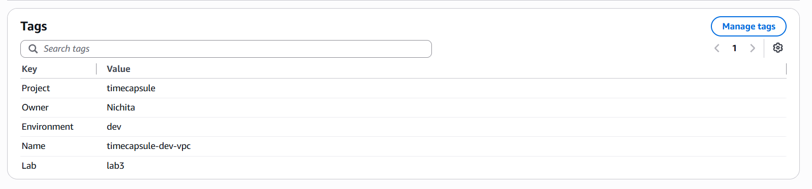

План подсетей:

| Подсеть | Зона доступности | Диапазон | Первый доступный адрес | Последний доступный адрес | Доступно адресов |
|---|---|---|---|---|---:|
| public-a | eu-central-1a | `10.23.0.0/24` | `10.23.0.4` | `10.23.0.254` | 251 |
| public-b | eu-central-1b | `10.23.1.0/24` | `10.23.1.4` | `10.23.1.254` | 251 |
| private-a | eu-central-1a | `10.23.10.0/24` | `10.23.10.4` | `10.23.10.254` | 251 |
| private-b | eu-central-1b | `10.23.11.0/24` | `10.23.11.4` | `10.23.11.254` | 251 |

В каждой подсети `/24` имеется 256 IPv4-адресов. AWS резервирует пять адресов, поэтому экземплярам доступны 251 адрес.
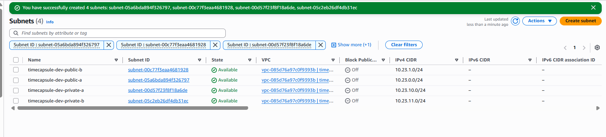
Для подсети `10.23.0.0/24` зарезервированы:

```text
10.23.0.0   — адрес сети
10.23.0.1   — маршрутизатор VPC
10.23.0.2   — DNS-сервер AWS
10.23.0.3   — зарезервирован AWS
10.23.0.255 — последний адрес подсети
```

### Контрольные вопросы

**Почему доступных адресов не 256?**

AWS резервирует первые четыре и последний адрес каждой подсети. Эти адреса нельзя назначать EC2-экземплярам.

**Сколько ещё подсетей /24 можно разместить в VPC `/16`?**

В сети `/16` помещается 256 подсетей `/24`. В работе используются четыре подсети, поэтому остаётся возможность создать ещё 252 подсети `/24`.

---

# 3. Задание 2. VPC и подсети

Была создана собственная VPC:

```text
Name: timecapsule-dev-vpc
IPv4 CIDR: 10.23.0.0/16
Region: eu-central-1
```

Для VPC были включены:

```text
Enable DNS resolution
Enable DNS hostnames
```

Внутри VPC были созданы четыре подсети:

```text
timecapsule-dev-public-a
timecapsule-dev-public-b
timecapsule-dev-private-a
timecapsule-dev-private-b
```

Они размещены в двух зонах доступности:

```text
eu-central-1a
eu-central-1b
```

Для ресурсов использовались обязательные теги:

```text
Project = timecapsule
Environment = dev
Owner = Nichita
Lab = lab3
```

### Контрольный вопрос

**Является ли public-a публичной сразу после создания?**

Нет. Само название подсети не делает её публичной. Публичной она становится только после появления маршрута `0.0.0.0/0` через Internet Gateway и возможности назначать экземплярам публичные IPv4-адреса.

---

# 4. Задание 3. Internet Gateway и таблицы маршрутов

Был создан Internet Gateway:

```text
timecapsule-dev-igw
```
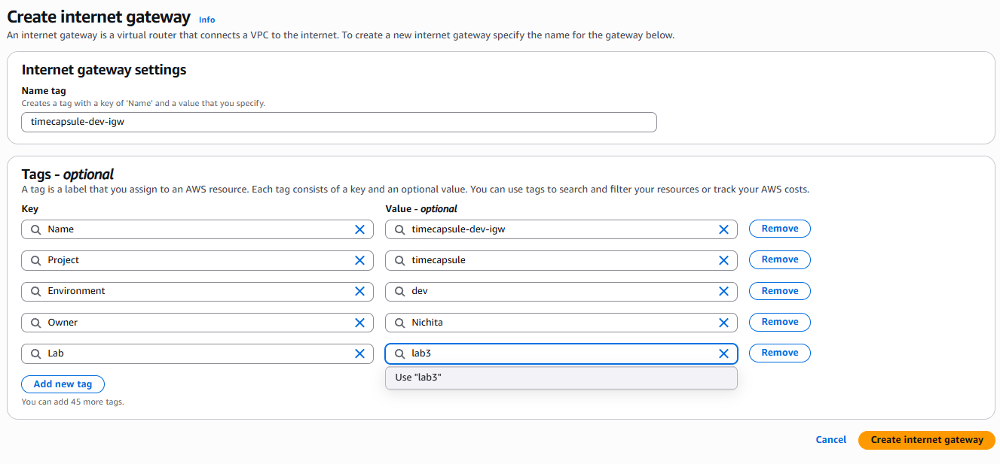\
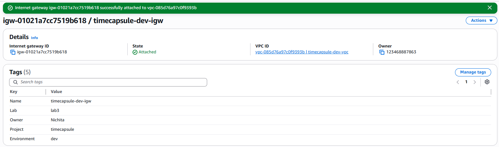
После создания он был подключён к:

```text
timecapsule-dev-vpc
```

Для публичных подсетей была создана таблица маршрутов:

```text
timecapsule-dev-public-rt
```

В неё был добавлен маршрут:

```text
Destination: 0.0.0.0/0
Target: timecapsule-dev-igw
```
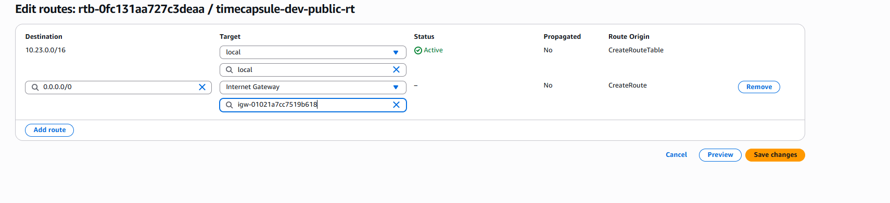
С таблицей были связаны:

```text
public-a
public-b
```

Для приватных подсетей была создана таблица:

```text
timecapsule-dev-private-rt
```

С ней были связаны:

```text
private-a
private-b
```

Постоянный маршрут в интернет для приватной таблицы не добавлялся.

Для публичных подсетей была включена настройка:

```text
Enable auto-assign public IPv4 address
```
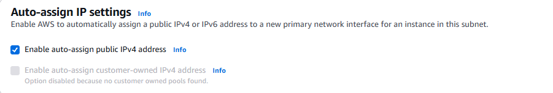
### Контрольные вопросы

**Какой маршрут присутствует в обеих таблицах автоматически?**

В каждой таблице есть локальный маршрут `local`, который позволяет ресурсам внутри одной VPC обмениваться трафиком между подсетями.

**Что произойдёт с пакетом из private-a на адрес 8.8.8.8?**

Если в private-rt отсутствует маршрут `0.0.0.0/0`, пакет не сможет выйти в интернет и будет отброшен.

---

# 5. Задание 4. Security Group

Были созданы три группы безопасности:

```text
timecapsule-dev-bastion-sg
timecapsule-dev-web-sg
timecapsule-dev-db-sg
```

Настроенные входящие правила:

| Security Group | Порт | Источник | Назначение |
|---|---:|---|---|
| bastion-sg | 22 | My IP | SSH на bastion |
| web-sg | 80 | `0.0.0.0/0` | HTTP-доступ к сайту |
| web-sg | 22 | bastion-sg | SSH на web-server только через bastion |
| db-sg | 5432 | web-sg | PostgreSQL только с web-server |
| db-sg | 22 | bastion-sg | SSH на db-server только через bastion |

Исходящий трафик был оставлен разрешённым по умолчанию.

### Контрольный вопрос

**Почему в db-sg источником для PostgreSQL указана web-sg, а не IP-адрес сервера?**

Использование Security Group в качестве источника не зависит от конкретного IP-адреса экземпляра. Любой сервер, которому назначена `web-sg`, сможет обращаться к базе по разрешённому порту, а остальные серверы — нет.

---

# 6. Задание 5. EC2-экземпляры и bastion

Были созданы три экземпляра Amazon EC2:

| Роль | Имя | Подсеть | Public IP | Security Group |
|---|---|---|---|---|
| bastion | `timecapsule-dev-bastion` | public-b | Enable | bastion-sg |
| web-server | `timecapsule-dev-web` | public-a | Enable | web-sg |
| db-server | `timecapsule-dev-db` | private-a | Disable | db-sg |

Все экземпляры использовали:

```text
Amazon Linux 2023
t3.micro
```
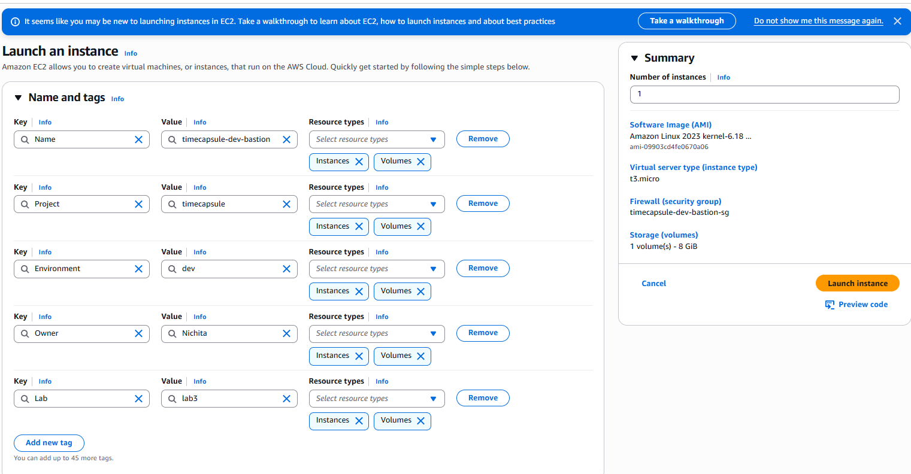
На web-server через User Data был установлен nginx:

```bash
#!/bin/bash
dnf -y install nginx
echo "<h1>$(hostname)</h1><p>$(hostname -I)</p>" > /usr/share/nginx/html/index.html
systemctl enable --now nginx
```
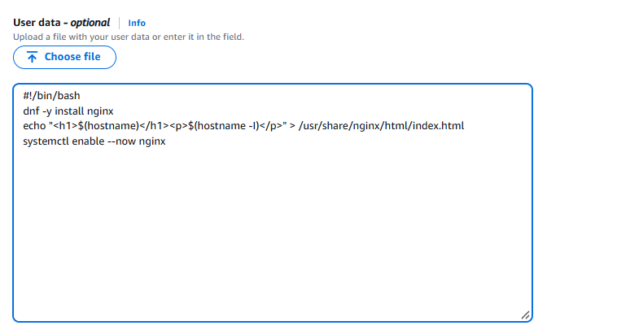
После запуска страница web-server стала доступна по его публичному IP.

Для доступа к серверам использовался bastion-host. На локальном компьютере был настроен SSH config.

Пример конфигурации:

```text
Host bastion
   HostName <PUBLIC_IP_BASTION>
   User ec2-user
   IdentityFile ~/.ssh/cloudstudent-keypair-new.pem

Host web
   HostName <PRIVATE_IP_WEB>
   User ec2-user
   IdentityFile ~/.ssh/cloudstudent-keypair-new.pem
   ProxyJump bastion

Host db
   HostName <PRIVATE_IP_DB>
   User ec2-user
   IdentityFile ~/.ssh/cloudstudent-keypair-new.pem
   ProxyJump bastion
```

Подключение выполнялось командами:

```bash
ssh bastion
ssh web
ssh db
```
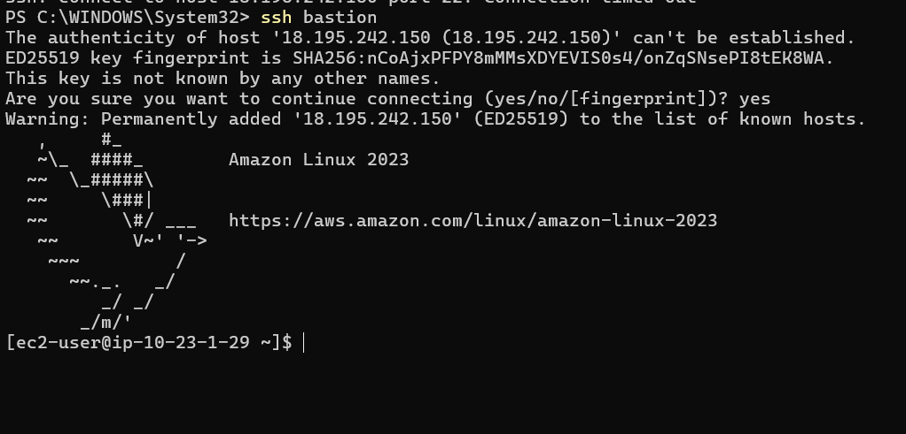
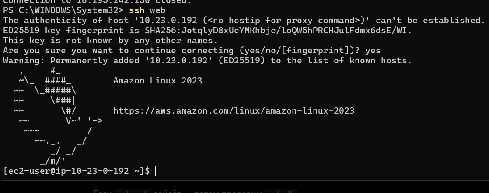
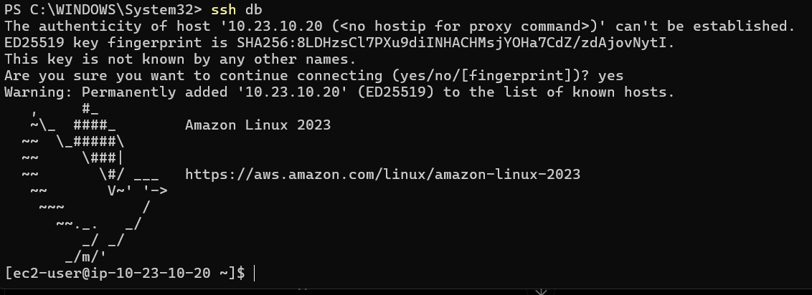

Приватный ключ на bastion не копировался.

После подключения к db-server была выполнена попытка:

```bash
sudo dnf -y install postgresql16-server
```
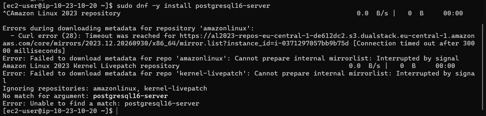
Без маршрута в интернет установка пакета не могла завершиться.

### Контрольный вопрос

**Почему db-server не может скачать пакеты?**

db-server находится в приватной подсети, не имеет публичного IP и не имеет маршрута в Internet Gateway. Для временного исходящего доступа в интернет необходимо использовать NAT Gateway.

---

# 7. Задание 6. Временный NAT Gateway

Для временного доступа db-server в интернет был создан NAT Gateway:

```text
timecapsule-dev-nat-a
```

Он размещался в:

```text
public-a
```

Для NAT Gateway был выделен Elastic IP:

```text
timecapsule-dev-nat-a-eip
```

В private-rt был временно добавлен маршрут:

```text
0.0.0.0/0 -> NAT Gateway
```

После этого на db-server была выполнена проверка внешнего IP:

```bash
curl https://checkip.amazonaws.com
```
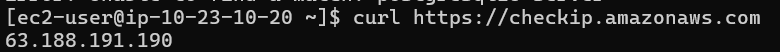
Полученный адрес совпадал с Elastic IP NAT Gateway, поскольку приватный сервер выходил в интернет через NAT.

После появления интернет-доступа были выполнены:

```bash
sudo dnf -y update
sudo dnf -y install postgresql16-server
```

PostgreSQL был инициализирован:

```bash
sudo postgresql-setup --initdb
```

Для приёма сетевых подключений была изменена настройка:

```bash
sudo sed -i "s/^#listen_addresses = 'localhost'/listen_addresses = '*'/'" /var/lib/pgsql/data/postgresql.conf
```

В `pg_hba.conf` было добавлено правило для публичной подсети:

```text
host  all  all  10.23.0.0/24  scram-sha-256
```

Сервис был запущен:

```bash
sudo systemctl enable --now postgresql
```

Для проверки были созданы пользователь и база данных:

```bash
sudo -u postgres psql -c "CREATE USER student WITH PASSWORD '********';"
sudo -u postgres psql -c "CREATE DATABASE lab3 OWNER student;"
```
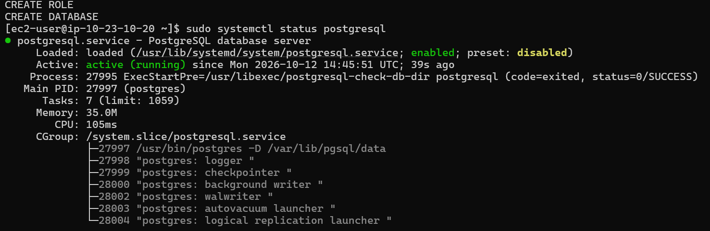
После установки пакетов временный NAT Gateway был удалён. Затем был удалён маршрут `0.0.0.0/0` из private-rt и освобождён его Elastic IP.
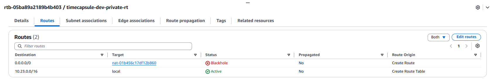
### Контрольные вопросы

**Почему внешний адрес db-server совпадает с Elastic IP NAT Gateway?**

db-server не имеет собственного публичного адреса. NAT Gateway подменяет исходный приватный адрес своим Elastic IP при выходе в интернет.

**Какие механизмы ограничивают доступ к PostgreSQL?**

Используются три уровня защиты: отсутствие публичного IP и прямого маршрута из интернета, Security Group `db-sg` и правила PostgreSQL в `pg_hba.conf`.

**Почему PostgreSQL продолжает работать после удаления NAT Gateway?**

NAT Gateway нужен только для исходящего доступа в интернет. Работа PostgreSQL внутри VPC от него не зависит.

**Что нужно сделать для будущего обновления пакетов?**

Временно снова создать NAT Gateway, добавить маршрут в private-rt, установить обновления, а затем удалить NAT Gateway и освободить Elastic IP.

---

# 8. Задание 7. Проверки

На web-server был установлен клиент PostgreSQL:

```bash
sudo dnf -y install postgresql16
```

Соединение с PostgreSQL на db-server проверялось командой:

```bash
psql -h <PRIVATE_IP_DB> -U student -d lab3 -c "SELECT version();"
```
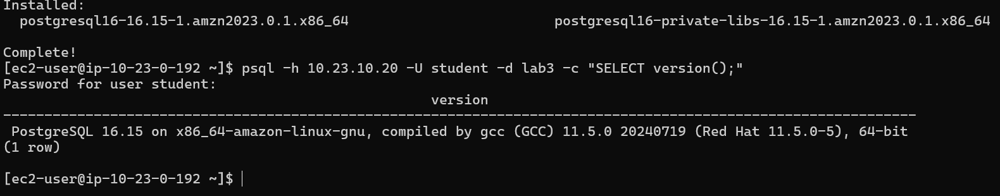
Успешное выполнение команды подтверждает, что web-server имеет доступ к PostgreSQL.

Порт 5432 проверялся с web-server:

```bash
timeout 5 bash -c '</dev/tcp/<PRIVATE_IP_DB>/5432' && echo open || echo closed
```

Ожидаемый результат:

```text
open
```

Та же проверка с bastion должна возвращать:

```text
closed
```
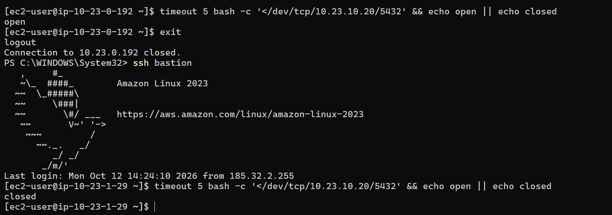
Это происходит потому, что `db-sg` разрешает PostgreSQL только от серверов, которым назначена `web-sg`.

После удаления NAT Gateway с db-server была выполнена команда:

```bash
curl -m 5 https://github.com
```
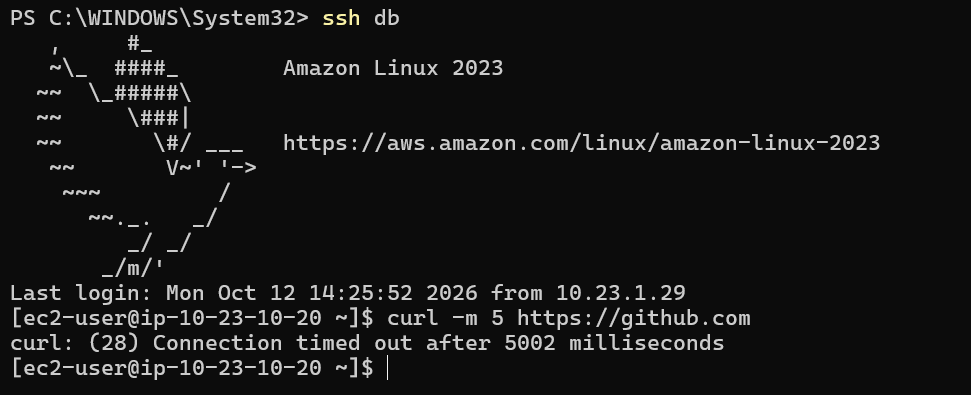
Соединение не устанавливалось, что подтверждает отсутствие постоянного выхода приватной подсети в интернет.

## Проверка Network ACL

В Network ACL VPC временно было добавлено правило:

```text
Rule number: 90
Type: All traffic
Source: мой внешний IP /32
Action: Deny
```
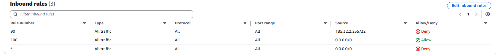
После этого соединение SSH с bastion блокировалось.
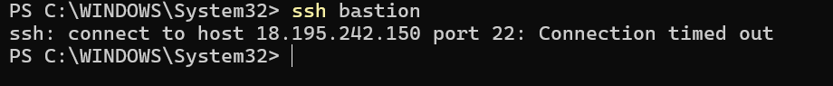
При открытии сайта с другого адреса, например через мобильную сеть телефона, сайт продолжал работать.

После удаления правила Network ACL нормальная работа соединений была восстановлена.

### Контрольные вопросы

**Почему порт 5432 открыт с web-server, но закрыт с bastion?**

Security Group базы разрешает PostgreSQL только от `web-sg`. Наличие общего локального маршрута VPC само по себе не означает, что трафик будет разрешён.

**Почему db-server не может обращаться к интернету после удаления NAT Gateway?**

В private-rt больше нет маршрута `0.0.0.0/0`. Кроме того, db-server не имеет публичного IP.

**Можно ли подключиться к PostgreSQL db-server напрямую из интернета?**

Нет. У db-server отсутствует публичный IP и нет маршрута для прямого входящего интернет-трафика. Дополнительно соединения фильтруются Security Group и PostgreSQL.

**Почему Network ACL может заблокировать SSH и HTTP независимо от Security Group?**

Network ACL работает на уровне подсети и фильтрует трафик до Security Group. Если пакет запрещён Network ACL, он не дойдёт до экземпляра.

**Почему правило Network ACL имеет номер 90?**

Правила Network ACL обрабатываются по возрастанию номера. Правило с меньшим номером проверяется раньше правил с большими номерами.

---

# 9. Имена и теги

Все ресурсы создавались с единым соглашением об именах.

Основные теги:

```text
Project = timecapsule
Environment = dev
Owner = Nichita
Lab = lab3
```

Для проверки ресурсов использовался:

```text
Resource Groups & Tag Editor
```

с фильтром:

```text
Region = eu-central-1
Project = timecapsule
```
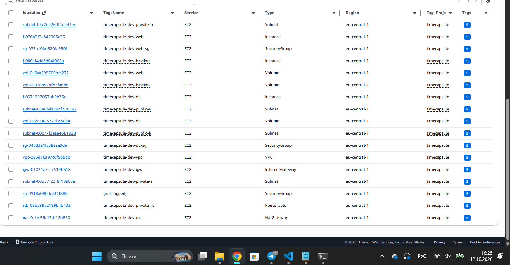
### Контрольные вопросы

**Как по тегам найти ресурсы проекта?**

Можно использовать Tag Editor и выполнить поиск по тегу `Project = timecapsule`, а при необходимости дополнительно фильтровать по `Environment`, `Owner` или `Lab`.

**Зачем нужен тег Owner?**

Он показывает, кто отвечает за конкретный ресурс. Это особенно важно в общем AWS-аккаунте, где ресурсы создают несколько пользователей.

---

# 10. Завершение работы

После выполнения базовой части были остановлены:

```text
timecapsule-dev-bastion
timecapsule-dev-web
timecapsule-dev-db
```
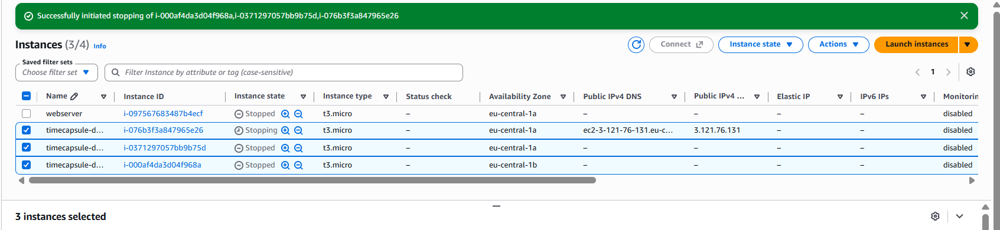
Также было проверено, что временный NAT Gateway удалён, а его Elastic IP освобождён.

VPC, подсети, таблицы маршрутов и Security Group оставлены, так как они не требуют оплаты и могут использоваться в следующих лабораторных работах.

---

# 11. Дополнительные ответы

### Как проходит трафик от пользователя к web-server?

Пользователь обращается к публичному IP web-server. Пакет проходит через Internet Gateway, публичную таблицу маршрутов и Network ACL подсети. После этого Security Group проверяет, разрешён ли HTTP-трафик на порт 80.

### Почему bastion используется отдельно?

Bastion является единственной точкой входа по SSH из интернета. web-server и db-server принимают SSH только от bastion-sg, поэтому административный доступ к внутренним серверам ограничен.

### Чем NAT Gateway отличается от Internet Gateway?

Internet Gateway обеспечивает прямой доступ публичных ресурсов к интернету. NAT Gateway используется приватными серверами только для исходящих соединений и не делает их напрямую доступными из интернета.

---

# 12. Итог

В ходе лабораторной работы была создана собственная VPC `timecapsule-dev-vpc` с диапазоном `10.23.0.0/16`.

Сеть была разделена на четыре подсети в двух зонах доступности. Для публичных подсетей был настроен Internet Gateway и отдельная таблица маршрутов. Приватные подсети не имеют постоянного выхода в интернет.

Были созданы три EC2-экземпляра: bastion, web-server и db-server. Доступ по SSH к web-server и db-server организован через bastion-host.

Для базы данных был создан отдельный Security Group, разрешающий PostgreSQL только от web-server. Для временной установки пакетов на db-server использовался NAT Gateway, который после завершения настройки был удалён.

Проверки подтвердили правильную работу маршрутизации, Security Group, Network ACL и изоляции приватного сервера базы данных.
