# Лабораторная работа №4. Облачные хранилища. Amazon S3

## Общая информация

**ФИО:** Murzacoi Nichita  
**Группа:** IA2403  
**Регион AWS:** `eu-central-1 (Frankfurt)`  
**Проект:** `timecapsule`  
**Уровень:** продвинутый  

---

# 1. Цель работы

Изучить работу Amazon S3, настроить безопасное хранение объектов, версионирование, жизненный цикл, IAM-права и подписанные ссылки, а затем перенести пользовательские вложения приложения TimeCapsule с локального диска EC2 в Amazon S3.

---

# 2. Задание 1. Бакет и объекты

Создан S3-бакет:

```text
timecapsule-dev-uploads-nichitamurzacoi
```
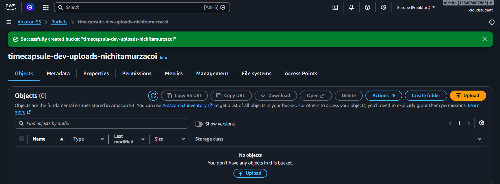
Основные параметры:

```text
Bucket type: General purpose
Region: eu-central-1
ACLs: Disabled
Block all public access: Enabled
Versioning: Disabled
Encryption: SSE-S3
```

Теги:

```text
Project = timecapsule
Environment = dev
Owner = Nichita
Lab = lab4
```

Созданы префиксы:

```text
uploads/
backups/
```
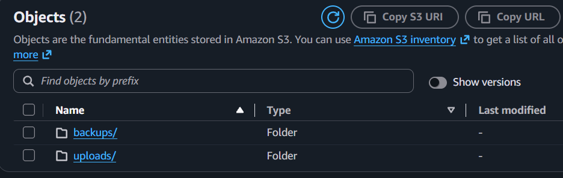
В `uploads/` загружены изображение и PDF, в `backups/` — текстовый файл.

Обычный Object URL не открывается, потому что публичный доступ к бакету запрещён.

---

# 3. Задание 2. Работа через AWS CLI

В CloudShell:

```bash
BUCKET=timecapsule-dev-uploads-nichitamurzacoi

mkdir -p lab4/2026/10 && cd lab4
echo "photo placeholder" > photo.txt
echo "october report" > 2026/10/report.txt
echo "october report 2" > 2026/10/report-2.txt

aws s3 cp photo.txt s3://$BUCKET/uploads/photo.txt
aws s3 sync 2026 s3://$BUCKET/uploads/2026
```

Проверка:

```bash
aws s3 ls s3://$BUCKET
aws s3 ls s3://$BUCKET/uploads/
aws s3 ls s3://$BUCKET --recursive
```

Скачивание и удаление:

```bash
aws s3 cp s3://$BUCKET/uploads/photo.txt downloaded.txt
aws s3 rm s3://$BUCKET/uploads/2026/10/report-2.txt
```
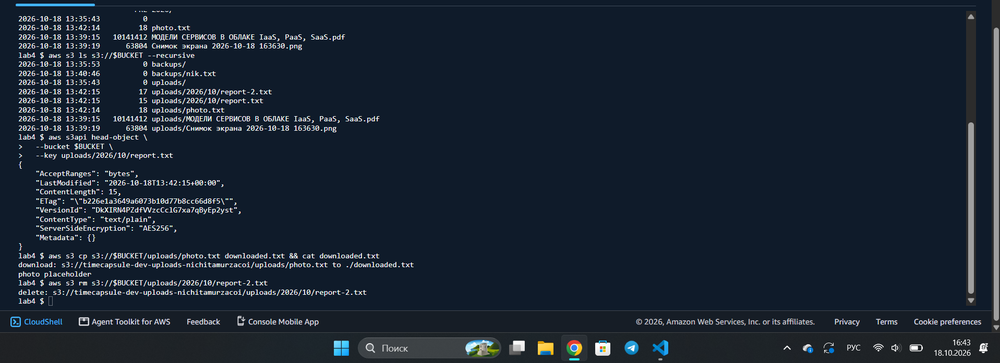
---

# 4. Задание 3. Bucket Policy — только HTTPS

Добавлена Bucket Policy, запрещающая запросы без HTTPS.
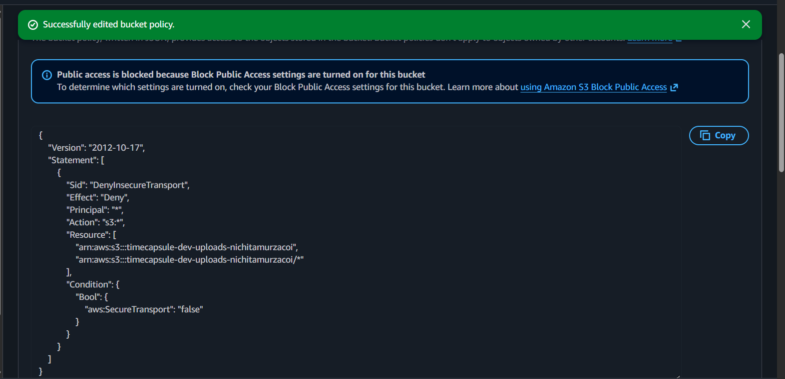
Проверка:

```bash
aws s3 ls s3://$BUCKET/uploads/

aws s3 ls s3://$BUCKET/uploads/ \
  --endpoint-url http://s3.eu-central-1.amazonaws.com
```

HTTPS-запрос работает, HTTP-запрос возвращает:

```text
AccessDenied
```
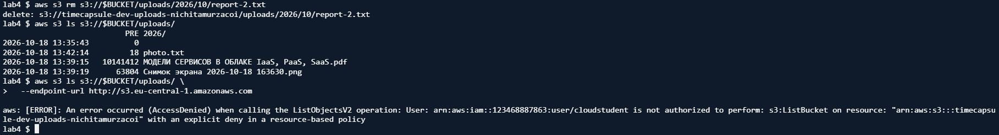
---

# 5. Задание 4. Версионирование

В бакете включено:

```text
Bucket Versioning: Enabled
```

Для файла:

```text
uploads/notes.txt
```

были созданы версии:

```text
v1
v2
```
При обычном удалении появился `Delete Marker`.
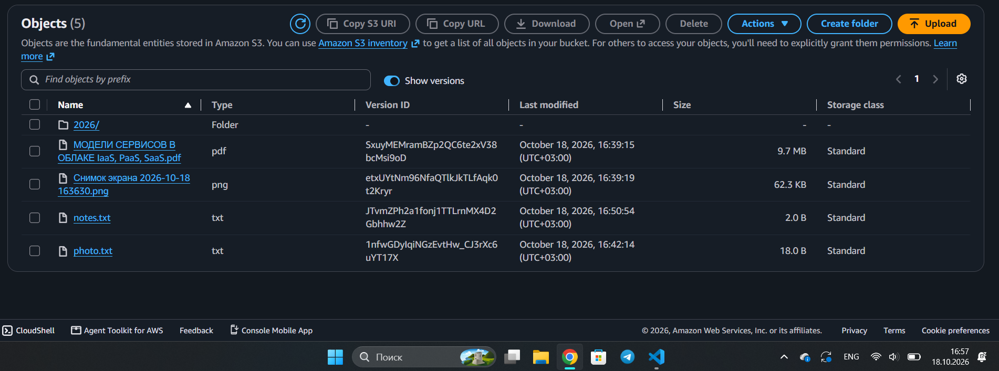
---
 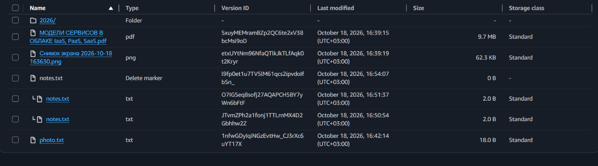
После удаления Delete Marker объект был восстановлен.


---

# 6. Задание 5. Lifecycle Rule

Создано правило:

```text
timecapsule-dev-noncurrent
```

Для префикса:

```text
uploads/
```

Настройки:

```text
Noncurrent versions -> Standard-IA after 30 days
Delete noncurrent versions after 90 days
Retain 2 newer versions
Abort incomplete multipart uploads after 7 days
```
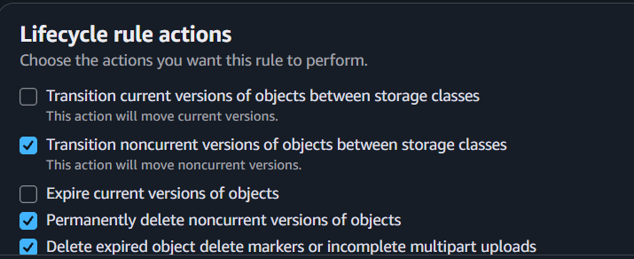
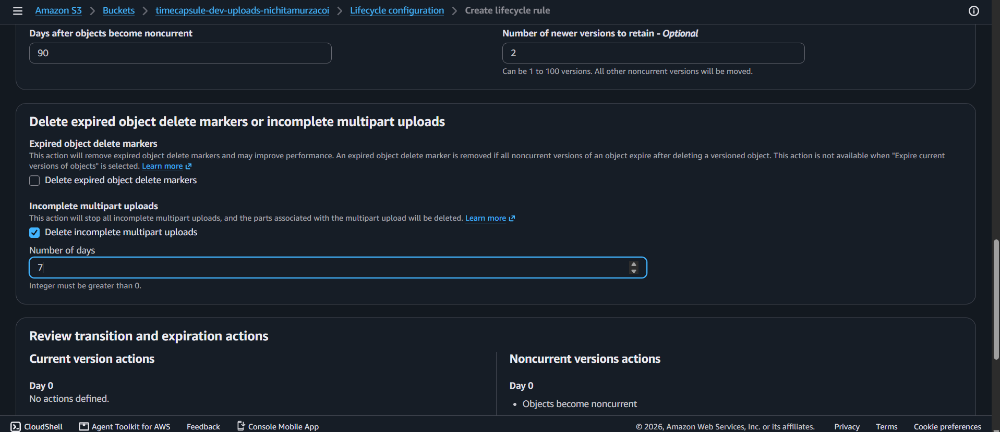

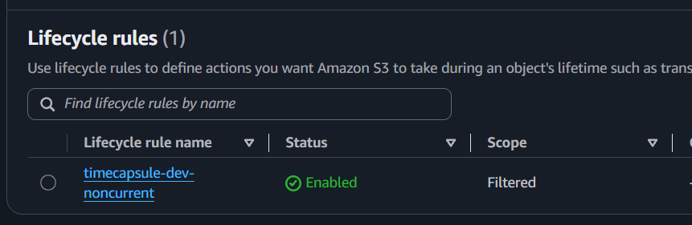
---

# 7. Задание 6. Presigned URL

Для объекта была создана временная подписанная ссылка.
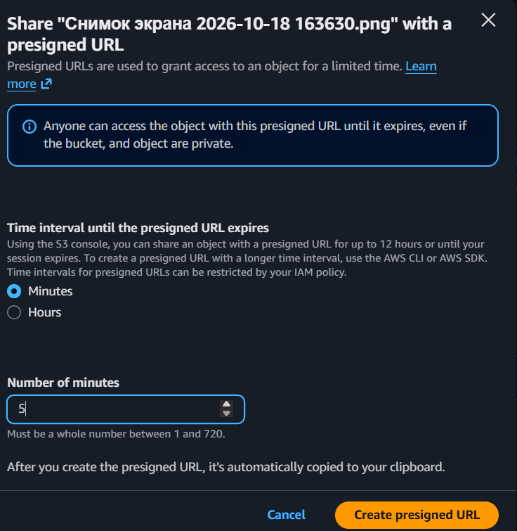
Через CLI:

```bash
aws s3 presign s3://$BUCKET/uploads/photo.txt --expires-in 120
```
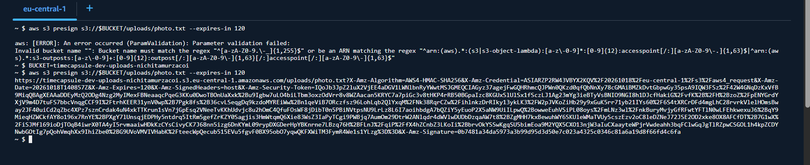
Изменение имени объекта в URL делает подпись недействительной.

После окончания срока действия ссылка также перестаёт работать.

---

# 8. Задание 7. IAM Policy приложения

Создана политика:

```text
timecapsule-dev-app-s3
```

Приложению разрешены действия:

```text
s3:ListBucket
s3:GetObject
s3:PutObject
s3:DeleteObject
```
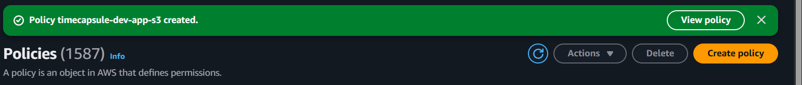
Доступ ограничен префиксом:

```text
uploads/
```

---

# 9. Задание 8. Тестовая IAM Role

Создана роль:

```text
timecapsule-dev-s3-tester
```

К ней прикреплена политика:

```text
timecapsule-dev-app-s3
```

Проверка показала:

```text
uploads/ -> Allow
backups/ -> AccessDenied
HTTP -> AccessDenied
```
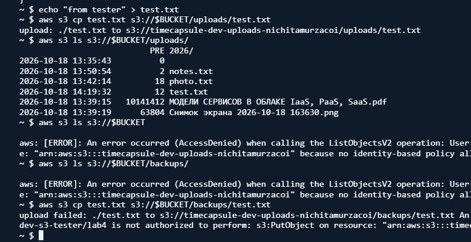
После проверки временные credentials удалены:

```bash
unset AWS_ACCESS_KEY_ID
unset AWS_SECRET_ACCESS_KEY
unset AWS_SESSION_TOKEN
```

---

# 10. Задание 9. IAM Role для app-server

Создана роль:

```text
timecapsule-dev-app-role
```

Trusted entity:

```text
EC2
```

Роль привязана к:

```text
timecapsule-dev-app
```
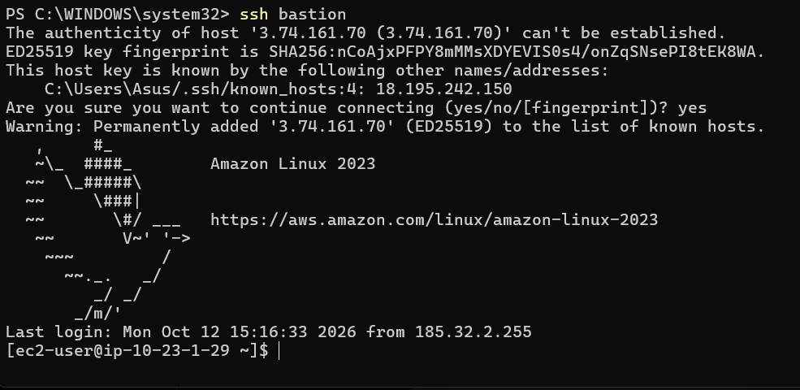
Проверка:

```bash
aws sts get-caller-identity
aws s3 ls s3://$BUCKET/uploads/
```
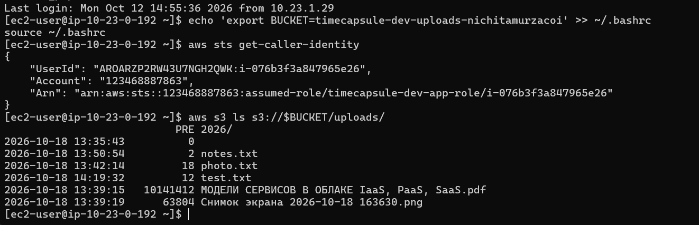
Постоянные Access Key на сервере не используются.

---

# 11. Задание 10. Перенос существующих файлов

На app-server:

```bash
cd /var/www/timecapsule/current

aws s3 sync storage/uploads s3://$BUCKET/uploads/ --dryrun
aws s3 sync storage/uploads s3://$BUCKET/uploads/
```

Повторный `--dryrun` подтвердил, что файлы синхронизированы.

---
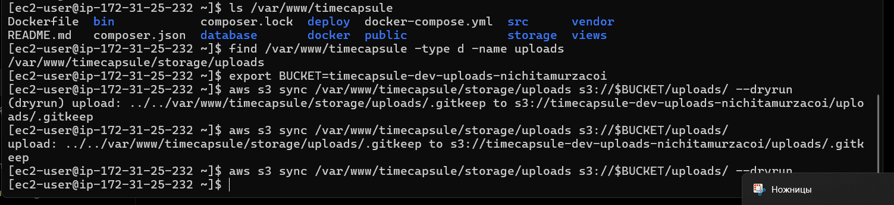

# 12. Задание 11. Работа приложения через S3

Добавлен AWS SDK:

```bash
composer require aws/aws-sdk-php
```

В `.env` добавлены:

```env
S3_BUCKET=timecapsule-dev-uploads-nichitamurzacoi
AWS_REGION=eu-central-1
```

Модуль:

```text
src/storage.php
```

изменён так, чтобы:

```text
storage_save() -> загружал файл в S3
storage_delete() -> удалял объект
storage_stream() -> создавал presigned URL
```
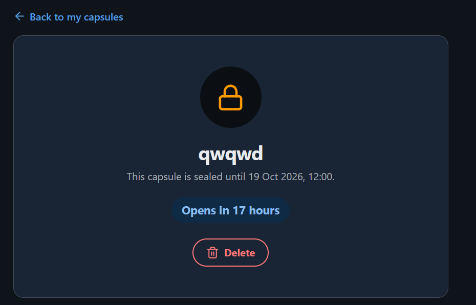
---

# 13. Задание 12. Деплой и проверка

После обновления приложения были проверены:

```text
загрузка изображения
загрузка PDF
Content-Type
presigned URL
старые вложения
удаление вложения
```
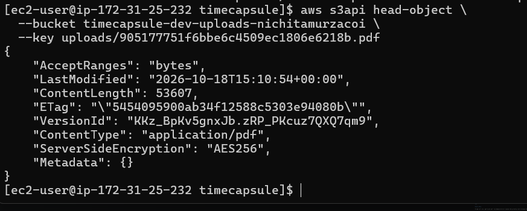
Файлы открываются напрямую из Amazon S3.

---

# 14. Задание 13. Сервер без локальных файлов

Локальная папка была временно перемещена:

```bash
sudo mv /var/www/timecapsule/current/storage/uploads ~/uploads-backup
```

Приложение продолжило работать.
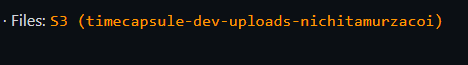
После проверки локальная копия была удалена:

```bash
sudo rm -rf ~/uploads-backup
```

После этого `s3:ListBucket` был удалён из политики приложения.

Приложение продолжило работать без локального хранения файлов.

---

# 15. Задание 14. Архитектура

Итоговая схема:

```text
Пользователь
    |
    v
app-server
    |
    | PutObject / DeleteObject
    v
Amazon S3
    |
    | Presigned URL
    v
Браузер
```

App-server получает доступ к S3 через:

```text
timecapsule-dev-app-role
```

Используется политика:

```text
timecapsule-dev-app-s3
```

---

# 16. ADR

Файл:

```text
docs/adr/0003-attachment-storage.md
```

## ADR-0003. Хранение пользовательских вложений

Рассматривались:

```text
EBS
EFS
Amazon S3
```

Выбран Amazon S3.

Причины:

- файлы не зависят от конкретного EC2;
- поддерживается Versioning;
- Lifecycle Rule ограничивает рост старых версий;
- Presigned URL позволяет временно выдавать доступ;
- несколько серверов приложения смогут использовать одно хранилище.

---

# 17. Итог

В лабораторной работе был настроен Amazon S3 для хранения пользовательских вложений TimeCapsule.

Были реализованы:

- закрытый S3-бакет;
- HTTPS-only Bucket Policy;
- Versioning;
- Lifecycle Rule;
- Presigned URL;
- IAM Policy;
- IAM Roles;
- перенос существующих файлов;
- работа приложения с S3 вместо локального диска.

В результате app-server больше не зависит от локальной папки `storage/uploads`.