# Лабораторная работа №5
## Облачные базы данных. Amazon RDS

**Студент:** Murzacoi Nichita  
**Группа:** IA2403  
**Регион AWS:** `eu-central-1`  
**Уровень:** базовый  

---

# 1. Цель работы

Изучить Amazon RDS, создать приватную базу PostgreSQL, настроить доступ к ней, создать Read Replica и выполнить восстановление базы после удаления данных.

---

# 2. Задание 1. DB Subnet Group и сетевой доступ

Для размещения базы данных была создана группа подсетей:

`lab5-db-subnets`

В неё были добавлены две приватные подсети из VPC `timecapsule-dev-vpc`:

- `timecapsule-dev-private-a`
- `timecapsule-dev-private-b`

База данных размещается только в приватной сети и не имеет прямого доступа из интернета.

Также была создана Security Group:

`lab5-rds-sg`

Входящий трафик PostgreSQL по TCP-порту `5432` разрешён только от Security Group web-server.

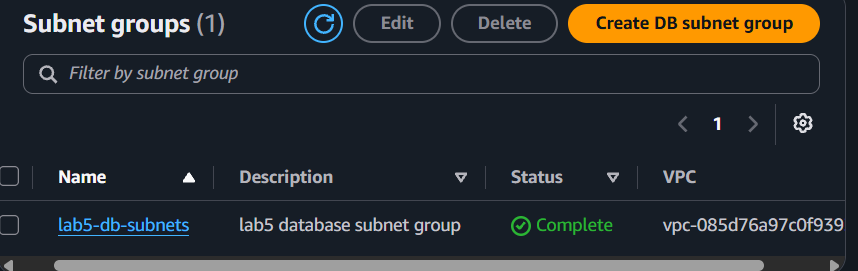

---

# 3. Задание 2. Создание Amazon RDS PostgreSQL

Был создан экземпляр базы данных:

`lab5-db`

Основные параметры:

```text
Engine: PostgreSQL
Instance class: db.t4g.micro
Storage: 20 GiB gp3
Initial database: lab5
Master user: dbadmin
Public access: No
Availability Zone: eu-central-1a
Backup retention: 7 days
Encryption: Enabled
Deletion protection: Enabled
```

После создания база перешла в состояние:

`Available`

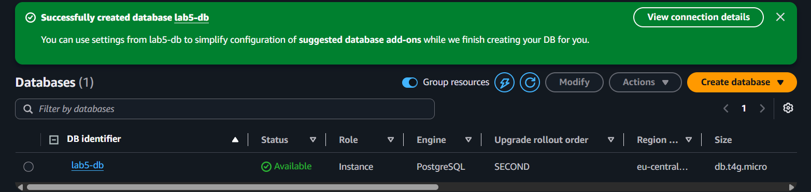

---

# 4. Задание 3. Подключение к базе данных

Подключение выполнялось с web-server по приватной сети.

Команда:

```bash
psql -h <RDS-ENDPOINT> -U dbadmin -d lab5
```

Для проверки соединения были выполнены:

```sql
SELECT version();
\conninfo
```

После этого была создана таблица:

```sql
CREATE TABLE notes (
    id SERIAL PRIMARY KEY,
    body VARCHAR(100) NOT NULL,
    created_at TIMESTAMPTZ NOT NULL DEFAULT now()
);
```

Добавлены тестовые данные:

```sql
INSERT INTO notes (body)
VALUES ('first'), ('second'), ('third');
```

Проверка:

```sql
SELECT * FROM notes;
```

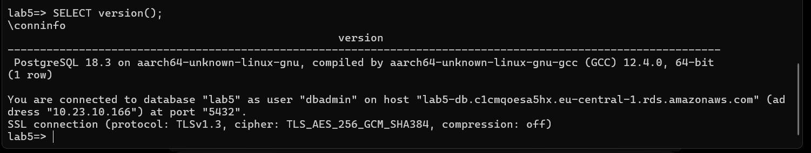
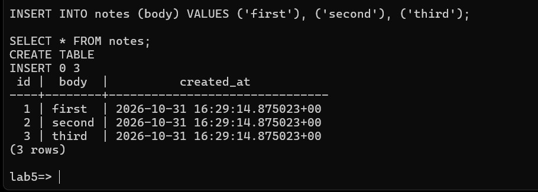

---

# 5. Задание 4. Read Replica

Для основной базы `lab5-db` была создана реплика:

`lab5-db-replica`

Параметры:

```text
Instance class: db.t4g.micro
Availability Zone: eu-central-1b
Public access: No
```
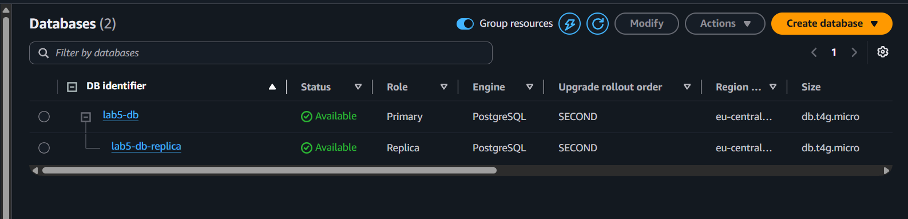
На реплике была выполнена команда:

```sql
SELECT pg_is_in_recovery();
```

На Read Replica результат:

```text
true
```

На основной базе:

```text
false
```

Попытка выполнить:

```sql
INSERT INTO notes (body) VALUES ('from replica');
```

завершилась ошибкой, так как Read Replica предназначена только для чтения.
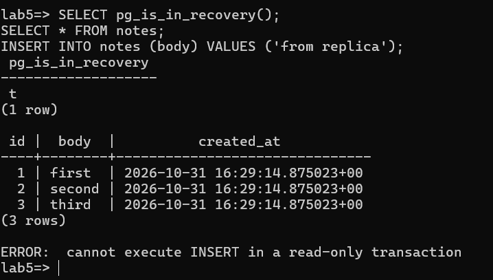

На основной базе была добавлена строка:

```sql
INSERT INTO notes (body) VALUES ('fourth');
```

После синхронизации строка появилась на реплике.
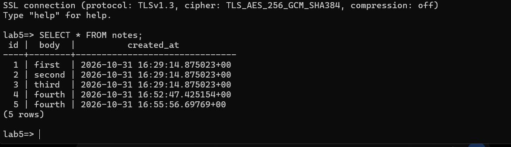
Также была проверена метрика:

`ReplicaLag`

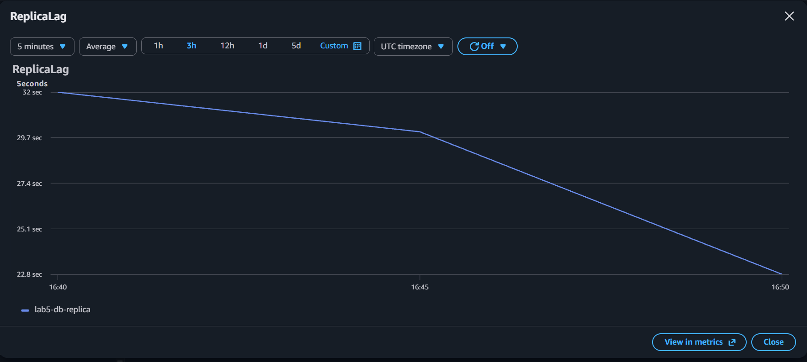

---

# 6. Задание 5. Восстановление базы после ошибки

Перед удалением данных было сохранено текущее UTC-время:

```sql
SELECT now() AT TIME ZONE 'UTC';
```
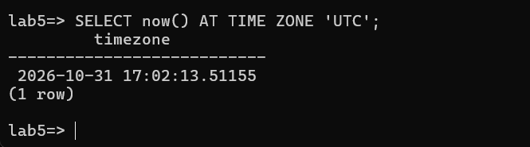
После этого были удалены все строки:

```sql
DELETE FROM notes;
```
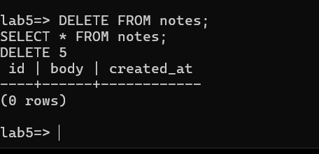
Для восстановления данных была использована функция:

`Restore to point in time`

База была восстановлена в новый экземпляр:

`lab5-db-restore`
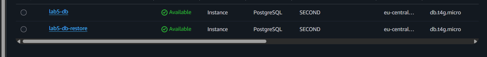

Для восстановления был выбран момент времени до выполнения команды `DELETE`.

После запуска восстановленной базы данные таблицы `notes` снова были доступны.
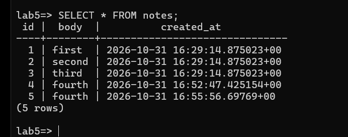


---

# 7. Очистка ресурсов

После завершения лабораторной работы временные ресурсы были удалены:

```text
lab5-db-replica
lab5-db-restore
lab5-db
lab5-db-subnets
lab5-rds-sg
```

Перед удалением основной базы была отключена:

`Deletion protection`

---
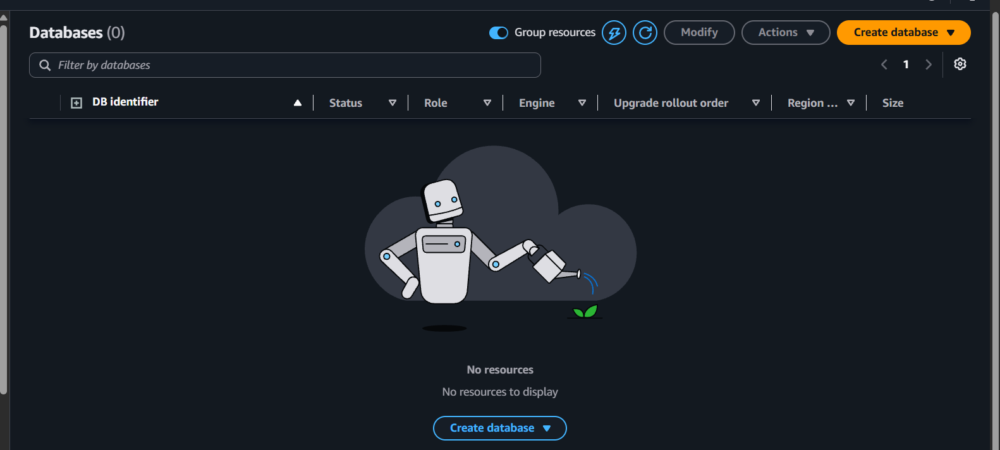
# 8. Контрольные вопросы

## Почему для доступа к RDS используется Security Group, а не IP?

Security Group удобнее, потому что IP-адрес EC2 может измениться. При использовании Security Group доступ остаётся корректным независимо от изменения IP.

## Почему используются две приватные подсети?

RDS требует DB Subnet Group с подсетями в нескольких Availability Zones. Это позволяет AWS размещать и восстанавливать ресурсы в разных зонах.

## Почему база не имеет Public Access?

База должна быть доступна только серверам приложения внутри VPC. Это уменьшает риск подключения к PostgreSQL напрямую из интернета.

## Почему INSERT на Read Replica не работает?

Read Replica предназначена только для чтения. Изменения выполняются на основной базе и затем реплицируются на копию.

## Чем Read Replica отличается от Multi-AZ?

Read Replica используется для чтения и масштабирования нагрузки.

Multi-AZ используется для высокой доступности и автоматического переключения при отказе основной базы.

## Почему реплика не спасает от случайного DELETE?

Команда `DELETE` также передаётся на Read Replica. Поэтому для восстановления старого состояния используются резервные копии и Point-in-Time Restore.

## Почему Restore to point in time создаёт новую базу?

AWS не откатывает существующую базу назад. Вместо этого создаётся новый экземпляр с состоянием базы на выбранный момент времени.

---

# 9. Итог

В ходе лабораторной работы была создана приватная база PostgreSQL в Amazon RDS.

Был настроен ограниченный доступ к базе через Security Group, выполнено подключение с EC2, создана таблица с тестовыми данными и Read Replica.

Также было выполнено восстановление базы после удаления данных с помощью Point-in-Time Restore.

После завершения работы временные ресурсы лабораторной были удалены.