# Лабораторная работа №6
## Балансировка нагрузки и автоматическое масштабирование. Amazon ELB и EC2 Auto Scaling

**Студент:** Murzacoi Nichita  
**Группа:** IA2403  
**Регион AWS:** `eu-central-1`  
**Уровень:** базовый  

---

# 1. Цель работы

Изучить Application Load Balancer и EC2 Auto Scaling, настроить распределение HTTP-запросов между несколькими серверами, проверить автоматическое масштабирование при увеличении и уменьшении нагрузки.

---

# 2. Задание 1. Application Load Balancer

Для балансировки HTTP-запросов была создана целевая группа:

`lab6-tg`

Основные параметры:

```text
Target type: Instances
Protocol: HTTP
Port: 80
VPC: timecapsule-dev-vpc
Health check path: /health
Health check interval: 10 seconds
```
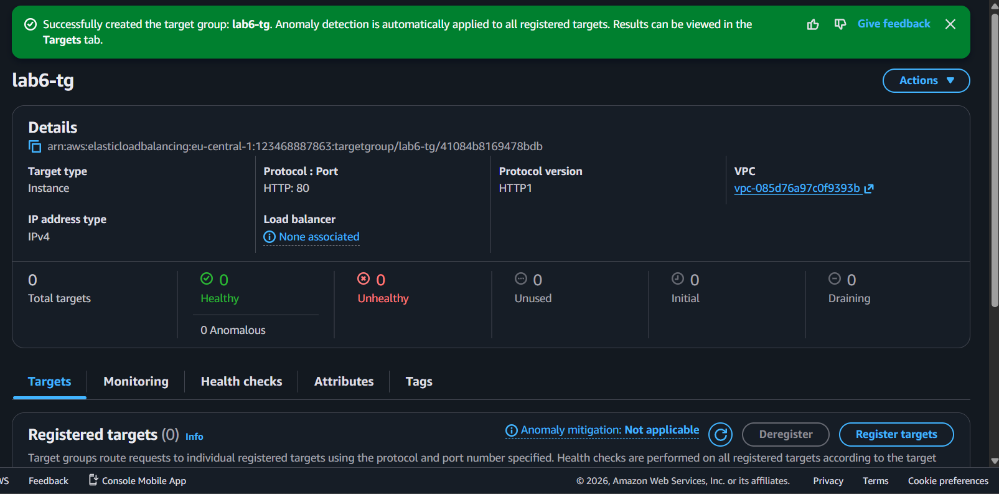
Также была создана Security Group:

`lab6-alb-sg`

Входящий HTTP-трафик на порт `80` разрешён из `0.0.0.0/0`.

Для балансировщика был создан экземпляр:

`lab6-alb`

Параметры:

```text
Type: Application Load Balancer
Scheme: Internet-facing
IP address type: IPv4
VPC: timecapsule-dev-vpc
Subnet 1: timecapsule-dev-public-a
Subnet 2: timecapsule-dev-public-b
Listener: HTTP:80
Target Group: lab6-tg
```

Балансировщик был размещён в двух зонах доступности:

```text
eu-central-1a
eu-central-1b
```

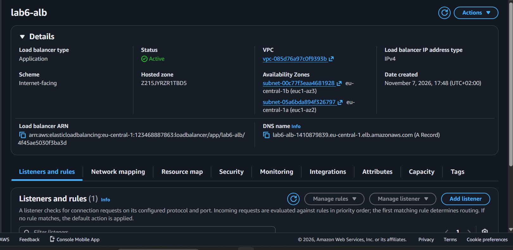

После создания был открыт DNS-адрес балансировщика.

До регистрации серверов балансировщик возвращал:

```text
503 Service Unavailable
```

Это связано с отсутствием исправных целей в Target Group.


---

# 3. Задание 2. EC2 Auto Scaling

Для автоматического запуска серверов был создан Launch Template:

`lab6-lt`

Параметры:

```text
AMI: Amazon Linux 2023
Instance type: t3.micro
Key pair: cloudstudent-keypair-new
HTTP: only from lab6-alb-sg
SSH: only from timecapsule-dev-bastion-sg
```

В User Data был добавлен скрипт:

```bash
#!/bin/bash
dnf install -y nginx

TOKEN=$(curl -s -X PUT \
"http://169.254.169.254/latest/api/token" \
-H "X-aws-ec2-metadata-token-ttl-seconds: 300")

AZ=$(curl -s \
-H "X-aws-ec2-metadata-token: $TOKEN" \
http://169.254.169.254/latest/meta-data/placement/availability-zone)

echo "<h1>$(hostname)</h1><p>Zone: $AZ</p>" \
> /usr/share/nginx/html/index.html

echo "OK" > /usr/share/nginx/html/health

systemctl enable --now nginx
```

Скрипт устанавливает nginx, определяет зону доступности сервера и создаёт страницы `/` и `/health`.
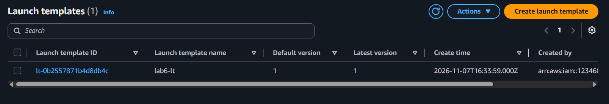


После этого была создана Auto Scaling Group:

`lab6-asg`

Параметры:

```text
Launch Template: lab6-lt
VPC: timecapsule-dev-vpc
Subnets: public-a, public-b
Target Group: lab6-tg
Health checks: ELB

Desired capacity: 2
Minimum capacity: 2
Maximum capacity: 4
```


Для группы была настроена политика:

`Target tracking scaling policy`

Метрика:

`Application Load Balancer request count per target`

Целевое значение:

`50`

После запуска группы два экземпляра EC2 были зарегистрированы в `lab6-tg` и перешли в состояние:

`healthy`

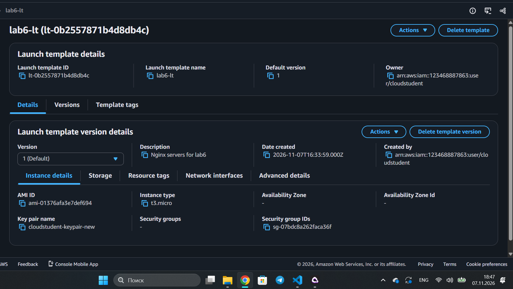
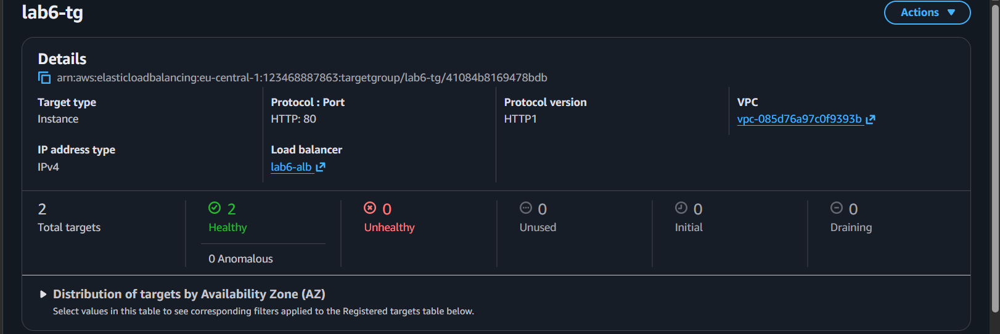

При открытии DNS-адреса балансировщика запросы распределялись между серверами.

Первый сервер:

```text
Zone: eu-central-1a
```
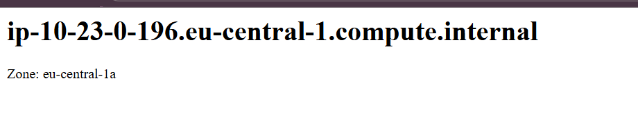


Второй сервер:

```text
Zone: eu-central-1b
```
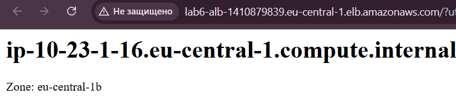

---

# 4. Задание 3. Нагрузочное тестирование

Для проверки автоматического масштабирования был запущен нагрузочный тест продолжительностью 10 минут.

Команда:

```bash
ALB=lab6-alb-1410879839.eu-central-1.elb.amazonaws.com

end=$((SECONDS+600))
while [ $SECONDS -lt $end ]; do
    curl -s -o /dev/null "http://$ALB/"
done
```
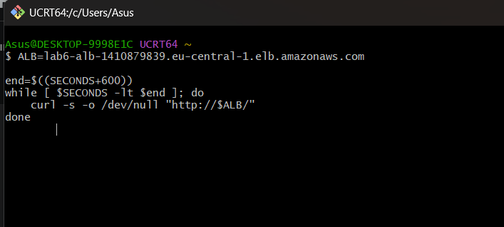
Скрипт непрерывно отправлял HTTP-запросы на балансировщик.


Во время тестирования в Amazon CloudWatch была проверена метрика:

`RequestCountPerTarget`

При увеличении нагрузки сработала тревога масштабирования:

`AlarmHigh`

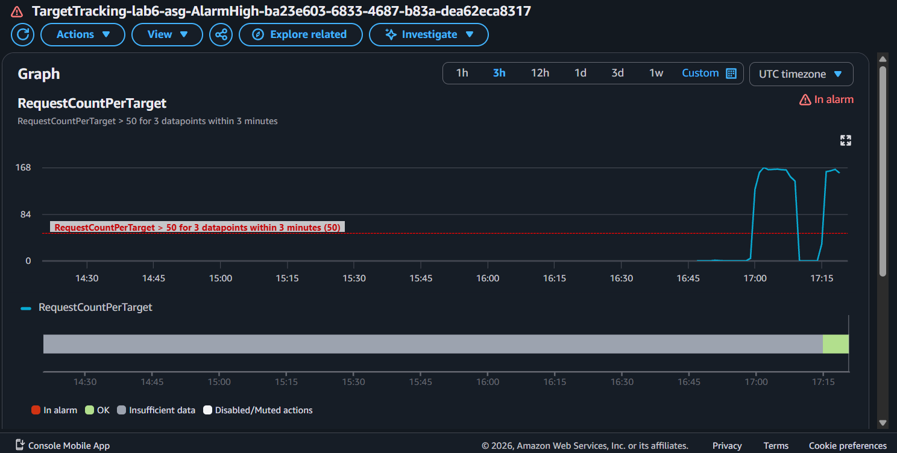
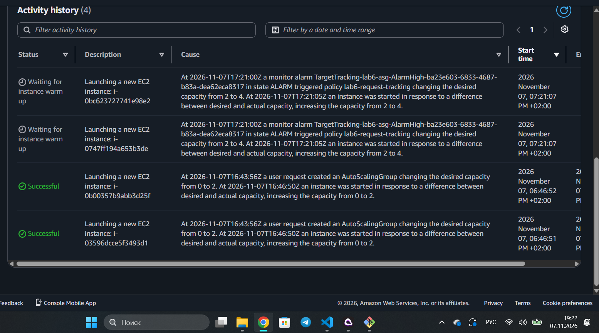

В разделе Auto Scaling Group → Activity была просмотрена история автоматического запуска экземпляров.

Количество серверов увеличилось:

```text
До нагрузки: 2
Во время нагрузки: 10
Maximum capacity: 4
```
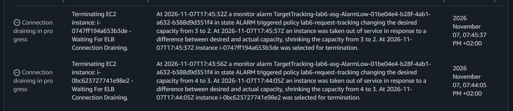


После завершения нагрузки количество запросов уменьшилось.

Auto Scaling Group постепенно удалила лишние экземпляры и вернулась к минимальному размеру:

`2`


---

# 5. Очистка ресурсов

После завершения лабораторной работы были удалены временные ресурсы:

```text
lab6-asg
lab6-alb
lab6-tg
lab6-lt
lab6-alb-sg
lab6-web-sg
```

Экземпляры EC2, созданные Auto Scaling Group, были завершены автоматически.

Также был остановлен bastion-host.
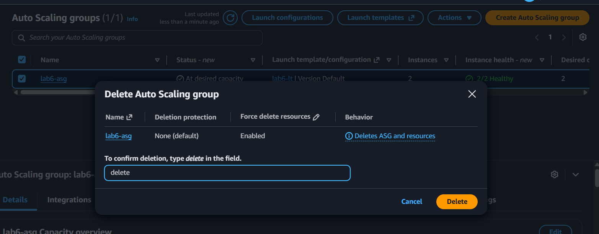


---

# 6. Контрольные вопросы

## Почему балансировщик сначала возвращает 503?

Потому что в целевой группе ещё нет исправных серверов. Балансировщику некуда перенаправлять HTTP-запросы.

## Зачем балансировщику подсети в двух зонах?

Это повышает отказоустойчивость. Если одна Availability Zone станет недоступной, запросы смогут обрабатываться серверами в другой зоне.

## Чем Auto Scaling Group отличается от Target Group?

Auto Scaling Group автоматически создаёт и удаляет экземпляры EC2 в зависимости от нагрузки.

Target Group содержит серверы, между которыми Application Load Balancer распределяет HTTP-запросы.

## Почему в Launch Template не указывается подсеть?

Подсети задаются в Auto Scaling Group. Благодаря этому группа может запускать серверы в разных Availability Zones.

## Сколько серверов запустила группа и почему не больше четырёх?

Во время нагрузки группа увеличила количество серверов до [указать фактическое число].

Больше четырёх серверов запустить нельзя, потому что в Auto Scaling Group установлен параметр `Maximum capacity = 4`.

## Почему метрика RequestCountPerTarget уменьшается после запуска новых серверов?

Потому что запросы начинают распределяться между большим количеством серверов. Средняя нагрузка на один экземпляр уменьшается, даже если общее количество запросов остаётся прежним.

## Почему Auto Scaling добавляет серверы быстрее, чем удаляет?

Быстрое добавление серверов помогает избежать перегрузки приложения.

Удаление происходит медленнее, чтобы не допустить частого изменения количества серверов при кратковременных колебаниях нагрузки.

---

# 7. Итог

В ходе лабораторной работы был настроен Application Load Balancer для распределения HTTP-запросов между экземплярами Amazon EC2.

Был создан Launch Template с автоматической установкой nginx и Auto Scaling Group с минимальным количеством двух и максимальным количеством четырёх серверов.

Настроены проверки работоспособности `/health` и политика Target Tracking по метрике `RequestCountPerTarget`.

Во время нагрузочного тестирования было исследовано автоматическое увеличение количества серверов и последующее возвращение группы к минимальному размеру.

После завершения работы временные ресурсы были удалены.
